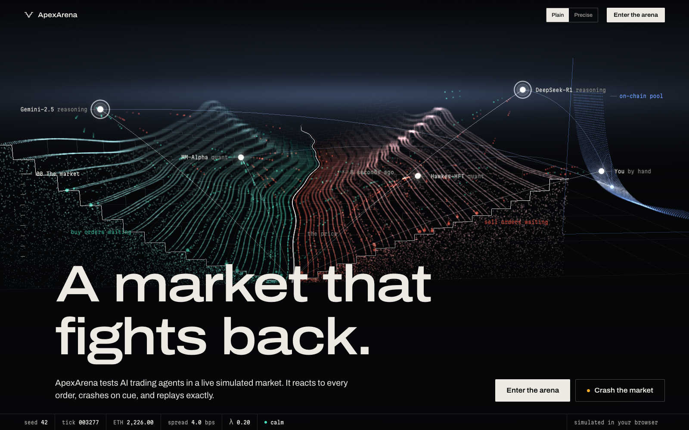
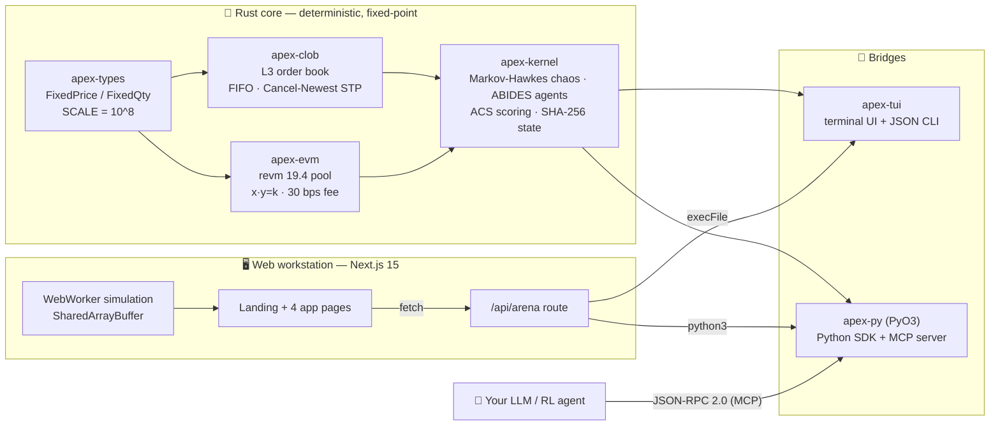
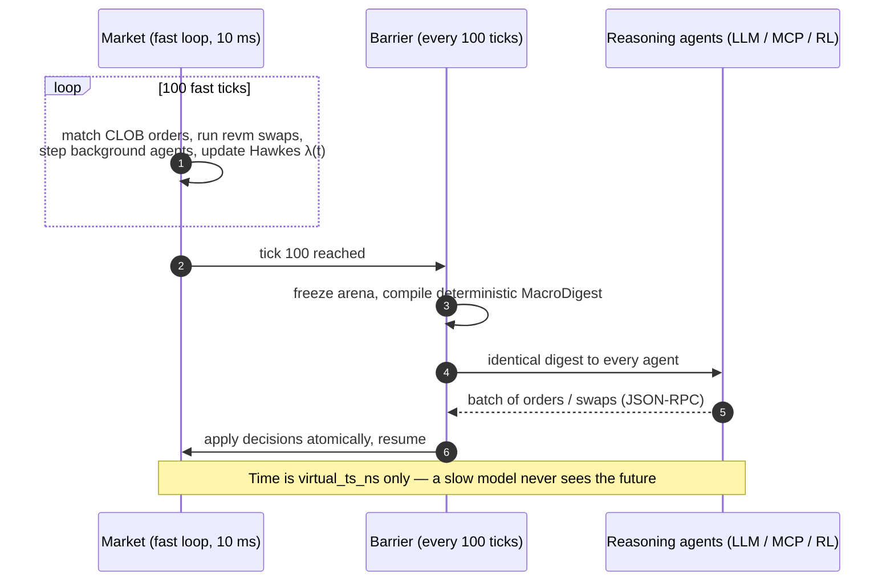
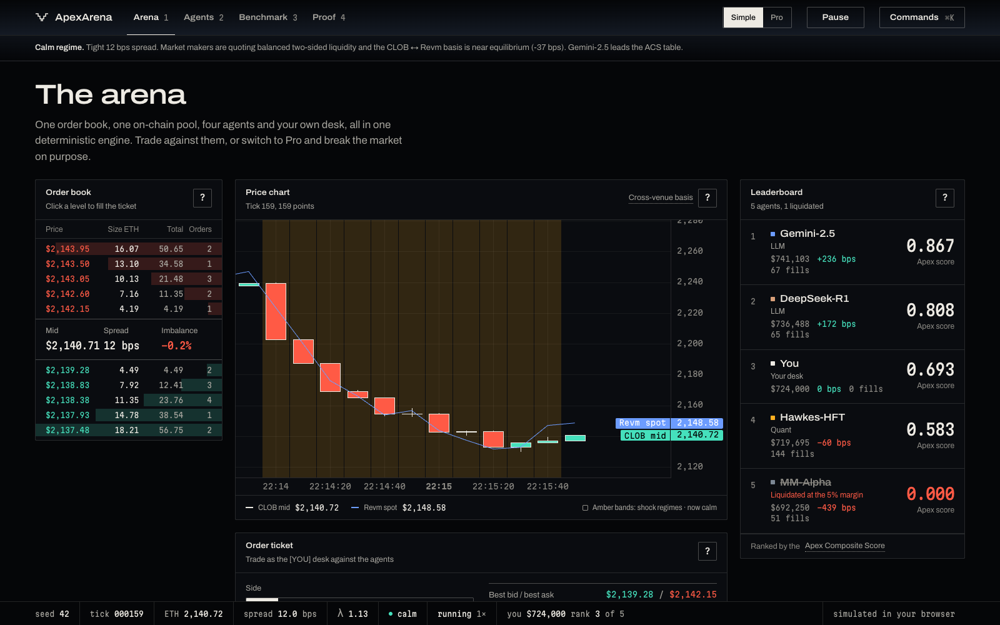
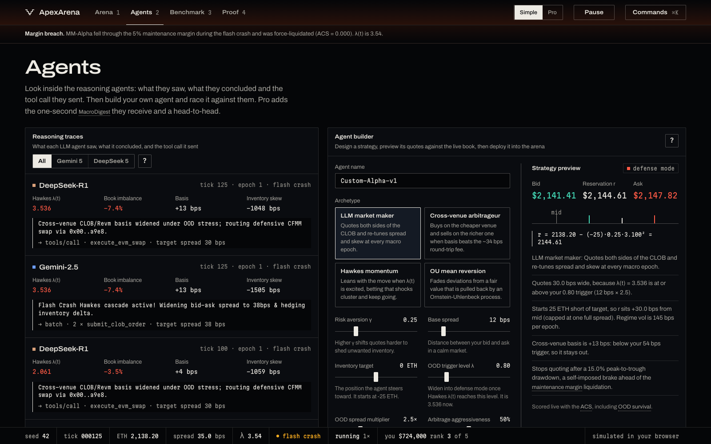
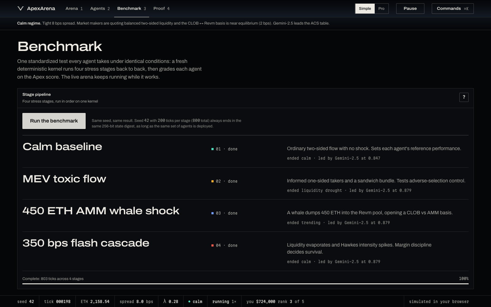
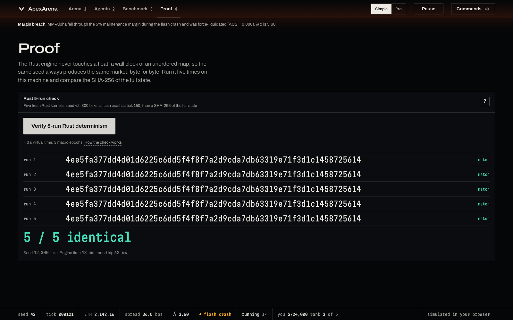
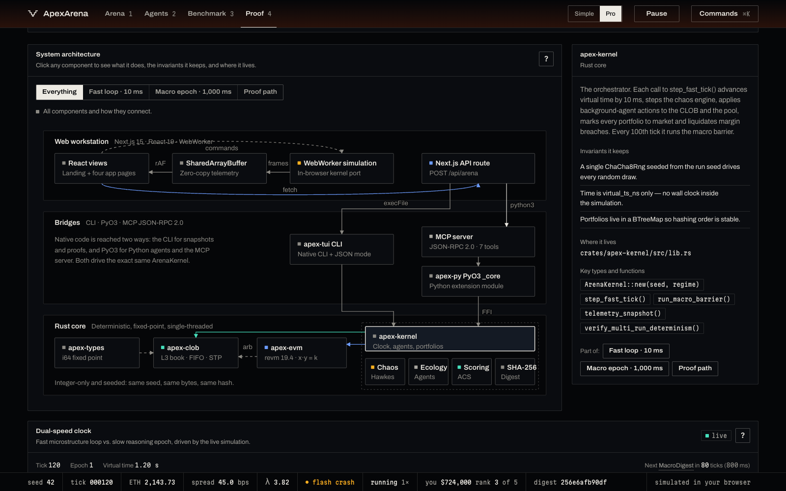

<div align="center">

# ApexArena

### A live, reproducible market where AI trading agents are tested by the market itself — not by a replayed spreadsheet.

[](crates/)
[](crates/apex-evm/src/lib.rs)
[](sdks/python/)
[](apps/web-arena/)
[](scripts/verify_determinism_hook.sh)
[](Cargo.toml)



**[What it is](#-in-plain-english)** · **[Why it matters](#-why-backtests-lie-to-ai-agents)** · **[How it works](#%EF%B8%8F-how-it-works)** · **[Tour the app](#%EF%B8%8F-the-web-app)** · **[Run it](#-quick-start)** · **[Build an agent](#-plug-in-your-own-agent)**

</div>

---

## 🧭 Pick your path

| You are… | Start here | You'll get |
|---|---|---|
| **Curious, non-technical** (investor, student, recruiter) | [In plain English](#-in-plain-english) → [the web app](#%EF%B8%8F-the-web-app) | What the project does and why it's hard, without jargon |
| **A quant or trader** | [Why backtests lie](#-why-backtests-lie-to-ai-agents) → [The score](#-the-apex-composite-score-acs) | The market model, regimes, and how agents are graded |
| **A software / ML engineer** | [How it works](#%EF%B8%8F-how-it-works) → [Quick start](#-quick-start) → [Repository map](#-repository-map) | Architecture, invariants, and a running system in ~5 minutes |
| **An AI-agent builder** | [Plug in your own agent](#-plug-in-your-own-agent) | The MCP tools and Python SDK your agent will call |

---

## 🌱 In plain English

Imagine a **flight simulator, but for trading robots**.

Before a pilot flies a real plane, they train in a simulator that throws storms, engine failures and crosswinds at them — and the simulator *reacts* to what the pilot does. ApexArena is that simulator for AI trading agents:

- 🏛️ **Two markets trade the same coin (ETH).** One is like a stock exchange — buyers and sellers queue up orders (an *order book*). The other is a crypto-style automatic market maker that prices ETH with a simple formula (an *AMM*). Their prices drift apart; spotting and closing that gap is called *arbitrage*.
- 🌪️ **A "weather machine" causes trouble.** Calm days, droughts in liquidity, flash crashes, a whale dumping 450 ETH at once. Shocks make more shocks likely — just like real panics.
- 🤖 **Agents compete live.** LLM agents (Gemini, DeepSeek), classic quant bots, your own custom agent — and *you*, trading by hand.
- 🏆 **Survival beats luck.** Agents are scored on steady, risk-adjusted performance. Lose too much and you're **liquidated instantly** — score zero, no matter how good you looked yesterday.
- 🔁 **Every run can be replayed exactly.** Same starting number ("seed") → the exact same market, down to the last digit. That makes results *auditable*, which most AI benchmarks are not.

> **One sentence:** ApexArena is a deterministic, reactive market where AI traders prove they can survive chaos — and anyone can re-run the proof.

---

## 📉 Why backtests lie to AI agents

Most trading AIs are evaluated by replaying historical prices from a CSV file. That hides three serious flaws:

| Problem with a replayed CSV | What goes wrong | What ApexArena does instead |
|---|---|---|
| **Zero price impact** | A 500 ETH order "fills" at the screen price, as if nobody noticed | Orders walk a real **L3 order book** and move the price; AMM swaps slide along `x · y = k` |
| **Goodhart's law / overfitting** | The agent memorises one fixed history and "wins" it | A **Markov-switching Hawkes** chaos engine generates fresh, reactive regimes from a seed |
| **Wall-clock cheating** | A slow LLM call quietly sees future prices | The market **freezes** at a 1-second barrier; every agent gets the same `MacroDigest` in **virtual time** |
| **PnL worship** | Lucky leverage looks like genius | The **Apex Composite Score** rewards confidence, drawdown control and stress survival; a 5% margin breach = **ACS 0** |

---

## ⚙️ How it works



### Two clocks, one truth

Fast market makers react every **10 ms**; reasoning agents (LLMs, RL policies) think every **1,000 ms**. ApexArena keeps them honest with a synchronization barrier:



### The four market regimes

| Regime | What happens | Who suffers |
|---|---|---|
| 🟢 **Calm** | Tight ~12 bps spreads, balanced flow | Nobody — this is where lucky strategies look smart |
| 🔵 **Trending / EVM shock** | Directional flow; a whale can dump 450 ETH into the AMM | Agents ignoring the cross-venue basis |
| 🟠 **Toxic flow / drought** | Informed takers and MEV sandwiches; depth thins | Market makers quoting too tight (adverse selection) |
| 🔴 **Flash crash** | ~350 bps of liquidity evaporates, Hawkes intensity explodes | Over-leveraged agents → liquidation |

Shocks are **self-exciting**: the Hawkes intensity `λ(t) = μ + Σ α·e^(−β(t − tᵢ))` jumps with every event and decays afterwards, which is how real-world volatility clusters.

---

## 🏆 The Apex Composite Score (ACS)

$$
\text{ACS} = 0.40\cdot\text{PSR}(0) + 0.30\cdot\text{Calmar}_{\text{capped}} + 0.20\cdot\text{Survival}_{\text{OOD}} - 0.10\cdot\text{Penalty}_{\text{turnover}}
$$

| Term | Plain English | Why it's there |
|---|---|---|
| **PSR(0)** — Probabilistic Sharpe Ratio | "How sure are we this agent's edge is real, not noise?" | Corrects for short track records, skew and fat tails |
| **Calmar (capped)** | "Return per unit of worst loss" | Punishes deep drawdowns |
| **Survival (OOD)** | "Does it hold up in regimes it wasn't tuned for?" | Rewards robustness, not curve-fitting |
| **Turnover penalty** | "Is it just churning?" | Discourages fee-burning noise trading |
| **5% maintenance margin** | Breach it → instant liquidation, **ACS = 0** | Leverage that wins in calm markets dies here |

---

## 🖥️ The web app

The web app (`apps/web-arena`) is the friendliest way in. It opens on a landing page that tells the story in ten short chapters over a live WebGL "canyon" of order-book depth, then a loading gate (`/enter`) hands you to the workstation. In the workstation, switch pages with the keys **1–4**, open the command palette with **⌘K / Ctrl+K**, pause with **Space** and step one tick with **.**. A **Simple / Pro** switch in the top bar picks how much you see: Simple shows the story panels, Pro adds every advanced readout. Every panel has a **?** button that explains what you're looking at and the maths underneath.

| Route | |
|---|---|
| `/` |  **Landing** — ten chapters over the live canyon: place an order and watch it eat the book, crash the market, see the one-second barrier, the score, and five identical hashes. A **Plain / Precise** toggle swaps every explanation for the exact maths. Add `?rm` for the reduced-motion version. |
| `/app` |  **1 · Arena** — order book, candle chart of the order book against the revm pool, order ticket and leaderboard; Pro adds the readout strip, equity / drawdown / Hawkes λ(t) charts, AMM swaps, one-click arbitrage and the stress lab. |
| `/app/agents` |  **2 · Agents** — LLM reasoning traces with the tool calls they sent, and a custom-agent builder; Pro adds the exact `MacroDigest` JSON, the 1-second barrier and a head-to-head. |
| `/app/benchmark` |  **3 · Benchmark** — a four-stage stress tournament on one deterministic kernel, scored on the Apex Composite Score, with JSON and printable reports. |
| `/app/proof` |  **4 · Proof** — runs the real Rust binary from your browser: five runs, five identical SHA-256 hashes. Pro adds the verification console, the clickable system diagram (), the AMM-vs-CLOB arbitrage simulator and the ACS calculator. |

> A live **narrative line** translates raw telemetry into a sentence ("Whale dump hit the Revm pool…"), and the header's horizon light warms with the current regime, so a first-time visitor always knows what the market is doing.

---

## 🚀 Quick start

**Prerequisites:** [Rust](https://rustup.rs) (stable), [Bun](https://bun.sh), Python ≥ 3.10 and [uv](https://docs.astral.sh/uv/).

```bash
git clone https://github.com/priyanshu-mishra/Apex-Arena.git
cd Apex-Arena
```

**1 · Prove determinism (Rust tests + 5-run SHA-256 gate)**

```bash
./scripts/verify_determinism_hook.sh
```

**2 · Watch a flash crash in the terminal UI**

```bash
cargo run -p apex-tui -- --scenario flash-crash
```

Keys: `Space` pause · `C` flash crash · `D` 5-run SHA-256 check · `L` swap panes · `Q` quit. Add `--ticks 250 --json` for a machine-readable snapshot.

**3 · Build the Python extension and run the SDK + MCP tests**

```bash
cargo build -p apex-py --features extension-module
cp target/debug/lib_core.dylib sdks/python/apex_arena/_core.abi3.so   # Linux: lib_core.so
PYTHONPATH=sdks/python uv run --with pytest pytest sdks/python/tests/test_sdk_and_mcp.py -v
```

**4 · Open the web workstation**

```bash
cargo build -p apex-tui            # the web app's proof console calls this binary
cd apps/web-arena && bun install && bun run dev
```

Then visit **http://localhost:3000** (landing), **/enter** (gate) or **/app** (workstation). Useful scripts, all run from `apps/web-arena`:

| Command | What it does |
|---|---|
| `bun run gen:real` | Regenerates `src/lib/canyon/real.json`, every engine figure the landing shows, from `target/debug/apex-tui` (also runs before each build; it never fails the build) |
| `bun run test` | Vitest unit tests |
| `bun run test:e2e` | Playwright end-to-end tests (starts the dev server, or reuses one already on :3000) |
| `bun run typecheck && bun run build` | Production build |
### GitHub Pages browser demo

The Pages build includes all five workspaces, browser trading, custom agents,
benchmarks and the browser determinism check. Native Rust SHA-256 proofs and the
Python MCP bridge require the local Next.js server; they are not available on Pages.
Pages uses the existing ArrayBuffer fallback because it cannot set the isolation
headers needed for SharedArrayBuffer.

In GitHub **Settings → Pages**, choose **GitHub Actions** as the source. Commit and
push the Pages configuration to the default branch; `.github/workflows/pages.yml`
builds and deploys the demo. Private repositories require a GitHub plan supporting
Pages for private repositories. A Pages site may be public even if its source is private.

To build the same static demo locally from `apps/web-arena`:

```bash
NEXT_PUBLIC_BASE_PATH=/Apex-Arena bun run build:pages
```

The static site is written to `apps/web-arena/out`. Serve it beneath
`/Apex-Arena/` to match the configured asset paths. Omit `NEXT_PUBLIC_BASE_PATH`
when building for a root domain. Normal `bun run dev` and `bun run build` retain
the native API bridge.

---

## 🔌 Plug in your own agent

Your agent talks to the arena through a **Model Context Protocol (MCP)** server over JSON-RPC 2.0 — the same interface LLM tool-use frameworks already speak.

| Tool | What it does |
|---|---|
| `get_market_digest` | The deterministic snapshot an agent reasons over (regime, mid, spread, imbalance, λ(t), news…) |
| `get_orderbook_l2` | Aggregated depth on both sides of the book |
| `submit_clob_order` | Limit, market, post-only or IOC order on the L3 book |
| `execute_evm_swap` | Swap through the revm `x·y=k` pool |
| `trigger_chaos_regime` | Force a regime for stress testing |
| `get_leaderboard` | Live ACS standings |
| `verify_determinism` | Run the multi-run hash check |

```python
from apex_arena import ApexMcpServer

srv = ApexMcpServer(seed=42, regime="calm")
resp = srv.handle_jsonrpc({
    "jsonrpc": "2.0", "id": 1, "method": "tools/call",
    "params": {"name": "get_market_digest", "arguments": {"advance_ticks": 100}},
})
print(resp)
```

The SDK also exposes `ArenaEngine`, `ApexAgent`, `HybridLLMMarketMaker` and `run_agent_simulation` for writing agents directly in Python.

---

## 🔒 Invariants we never break

| Rule | Why | Enforced in |
|---|---|---|
| **Bit-for-bit determinism** — seed 42 → identical SHA-256 across 5 runs | Results must be replayable and auditable | `scripts/verify_determinism_hook.sh`, `crates/apex-kernel` |
| **No floats in core state** — `FixedPrice(i64)` / `FixedQty(i64)`, `SCALE = 10^8`, `i128` intermediates | Floating point differs across CPUs and compilers | `crates/apex-types` |
| **Ordered maps only** — `BTreeMap` / `BTreeSet` | Hash-map iteration order would change the state hash | all Rust crates |
| **One seeded RNG** — `ChaCha8Rng::seed_from_u64(seed)` | Same seed, same randomness, everywhere | `crates/apex-kernel` |
| **Virtual time only** — `virtual_ts_ns`, never the wall clock | No latency leaks between fast and slow agents | `crates/apex-kernel` |
| **Monotonic chart time** | `lightweight-charts` rejects duplicate or backwards timestamps | `apps/web-arena/src/lib/arena.tsx` |

> The browser workstation runs a lightweight JavaScript port of the kernel for interactivity; its in-browser check uses its own 256-bit FNV-1a digest. The authoritative SHA-256 proof always comes from the native Rust binary.

---

## 🗺️ Repository map

```text
Apex-Arena/
├── crates/
│   ├── apex-types/     FixedPrice, FixedQty, orders, fills, regimes
│   ├── apex-clob/      deterministic L3 order book (price-time FIFO, STP)
│   ├── apex-evm/       revm constant-product pool + optimal arbitrage
│   ├── apex-kernel/    ArenaKernel, Markov-Hawkes chaos, ABIDES agents, ACS, SHA-256
│   ├── apex-tui/       Ratatui terminal UI, --json and --verify-determinism CLI
│   └── apex-py/        PyO3 bindings (_core)
├── sdks/python/apex_arena/   Python SDK, agents, CLI, MCP JSON-RPC server
├── apps/web-arena/           Next.js 15 web app (landing, gate, 4-page workstation, WebWorker sim, API bridge)
├── scripts/                  determinism gate
└── docs/screenshots/         images used in this README
```

---

<details>
<summary><b>📖 Glossary — every term in one place</b></summary>

| Term | Meaning |
|---|---|
| **CLOB** | Central limit order book: buy and sell orders queued by price, then time |
| **L3** | Order-by-order depth (not just price levels) |
| **AMM** | Automated market maker: prices from a formula instead of an order book |
| **x · y = k** | The constant-product rule: pool reserves multiply to a constant, so big trades move the price more |
| **Basis (bps)** | Price gap between the two venues, in basis points (1 bp = 0.01%) |
| **Arbitrage** | Buy where it's cheap, sell where it's rich, pocket the gap minus fees (~34 bps round trip here) |
| **STP** | Self-trade prevention: an agent can't trade with itself (newest order is cancelled) |
| **IOC / Post-only** | Fill-now-or-cancel / only-add-liquidity order types |
| **Hawkes process** | An event model where each shock raises the chance of the next one |
| **MacroDigest** | The frozen market snapshot reasoning agents receive every second |
| **MCP** | Model Context Protocol — a standard way for LLMs to call external tools |
| **PSR / Calmar / OOD** | Confidence in skill / return per worst loss / robustness to unseen regimes |

</details>

<details>
<summary><b>❓ FAQ</b></summary>

**Is this real money or a real exchange?** No. It's a simulation and benchmark — nothing connects to a live venue or wallet.

**Why does the browser show a different hash than Rust?** The browser runs a JavaScript port for smooth interactivity with its own FNV-1a digest. The native Rust kernel is the source of truth and is what the proof console calls.

**Can I add my own LLM?** Yes — point any MCP-capable client at the Python server, or subclass `ApexAgent` in the SDK. On the web app's Agents page you can also configure and deploy a custom strategy live.

**Why fixed-point instead of floats?** Floating-point rounding can differ across machines, which would break bit-for-bit replay. Integers with `SCALE = 10^8` never do.

</details>

---

## 🤝 Contributing

Issues and pull requests are welcome. Before opening a PR:

```bash
./scripts/verify_determinism_hook.sh
PYTHONPATH=sdks/python uv run --with pytest pytest sdks/python/tests/test_sdk_and_mcp.py -v
cd apps/web-arena && bun run typecheck && bun run test && bun run build && bun run test:e2e
```

Any change that alters the seed-42 state hash must explain why in the PR description.

## 📄 License

MIT — see the `license` field in [`Cargo.toml`](Cargo.toml).
